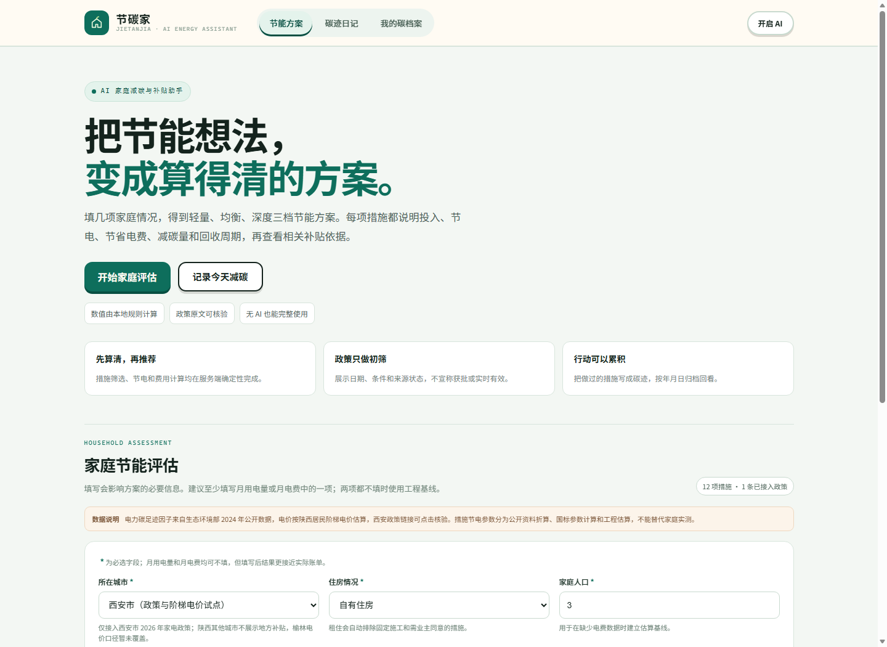
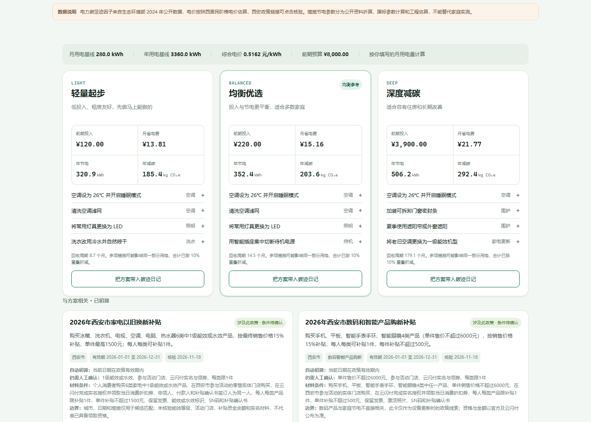
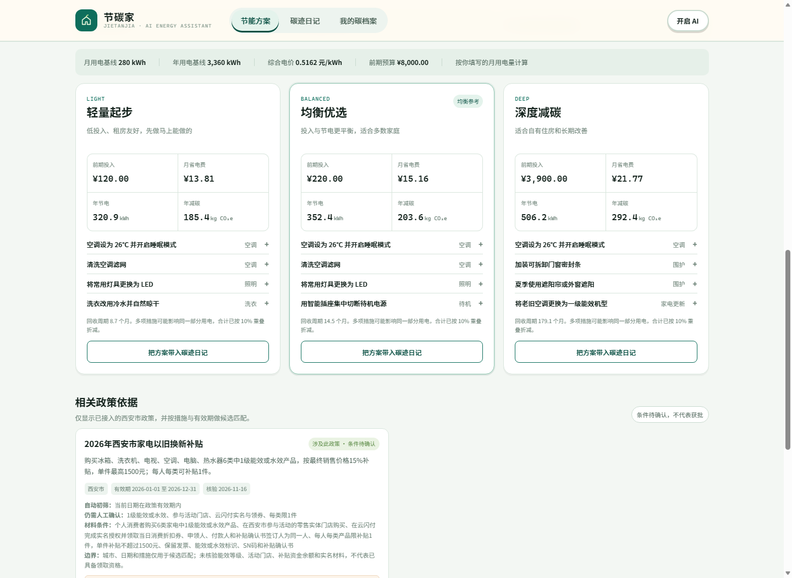
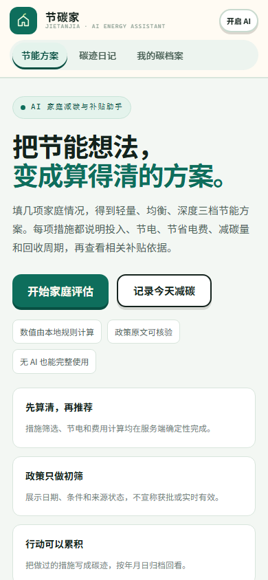

# 节碳家 · AI 家庭减碳助手技术报告

> 第九届“传智杯”全国大学生计算机应用能力与数字素养大赛  
> AI Web 网页开发赛道（赛道页面编号 10037）  
> 团队：Crownbreaker  
> 版本：2026 年 11 月

## 执行摘要

节碳家是一款面向家庭场景的 AI 减碳决策 Web 应用。项目把“评估家庭条件、生成三档节能方案、匹配补贴依据、记录实际行动”放在同一条使用链路中，解决家庭节能建议碎片化、投入回收不透明和政策信息难辨真假的问题。

产品以确定性计算为可信边界：节电量、费用、减碳量、回收周期和政策资格均由服务端规则计算；大模型只基于当前方案和检索到的政策条款组织解释。无模型 Key、模型超时或返回异常时，规则方案与政策初筛仍可完整运行。碳迹记录区分“已完成”和“计划执行”，避免把计划当作实际减排成果。

当前版本已实现三档方案、政策初筛、可降级 AI 解释、账号与年月日碳迹归档，并完成 146 项离线自动化测试和桌面/移动端浏览器验收。另提供无需服务器的离线演示网页，可直接发给评审或队友查看核心交互。仓库中的措施、排放因子、电价和政策均为明确标注的演示数据，不作为真实申领或投资依据。

## 1. 项目概述

### 1.1 背景与问题

家庭节能通常卡在三个环节：

1. 不知道该做哪些措施，网上建议碎片化；
2. 不知道投入多少、能省多少、多久回本；
3. 不知道是否有适用政策，也分不清真实政策与营销信息。

现有工具往往只给节能知识，或只做账单展示，缺少从家庭条件到措施组合、估算、政策依据和行动记录的完整链路。

### 1.2 产品定位

节碳家面向家庭用户，提供：

- 基于家庭条件的轻量、均衡、深度三档节能方案；
- 可解释的节电、费用、减碳量与回收周期估算；
- 带日期、资格状态和来源说明的补贴规则初筛；
- 区分“已完成”与“计划执行”的碳迹档案。

### 1.3 目标用户

- 想降低电费但不知道从哪里开始的普通家庭；
- 租住、预算有限、无法进行固定施工的年轻租户；
- 准备更换家电、希望先了解投入回收与政策条件的家庭；
- 社区、物业或节能宣传活动中的辅助咨询人员。

### 1.4 核心目标

- 一次评估形成三档可比较方案；
- 关键数字有计算公式、假设和版本；
- AI 不可用时核心流程仍完整可用；
- 政策不伪造、不冒充官方、不承诺申领成功。

## 2. 需求分析与功能范围

### 2.1 核心用户路径

```text
填写家庭条件
  → 生成三档方案
  → 比较投入、节电、费用和减碳
  → 查看相关补贴初筛及依据
  → 选择一项措施记入碳迹
  → 在碳档案中按日期回看
```

### 2.2 首版功能

| 模块 | 功能 |
|---|---|
| 家庭评估 | 城市、住房类型、人口、月电量、月电费、前期预算 |
| 三档方案 | 措施筛选、预算裁剪、节电/费用/减碳/回收周期 |
| 政策初筛 | 城市、日期、住房、措施匹配及原因 |
| AI 解释 | 方案解释、政策条款摘要、失败回退 |
| 碳迹日记 | 已完成/计划执行、反馈生成、保存 |
| 碳档案 | 年/月/日归档、搜索、日期筛选、删除、计划转完成 |
| 离线演示 | 无需服务器的单文件交互版，内置相同规则与演示数据 |

### 2.3 明确不做

- 不提供真实补贴申领、支付或订单；
- 不接入智能家居控制；
- 不承诺全国实时政策覆盖；
- 不把估算值描述为经核查的实际减碳量；
- 当前版本不做账单 OCR 和自主多 Agent。

### 2.4 界面示例









## 3. 系统架构

### 3.1 总体架构

```text
浏览器单页前端（原生 HTML/CSS/JS）
  │ 同源 HTTPS，可选分享码
  ▼
Flask 单端口应用
  ├─ 安全中间件：限流、分享码、安全响应头、Key 脱敏
  ├─ 账号与碳迹蓝图：SQLite
  ├─ 节能服务：输入校验、措施筛选、三档计算
  ├─ 政策服务：规则初筛、元数据过滤、本地条款检索
  └─ 模型适配：OpenAI 兼容调用、结构校验、自动降级
  ▼
版本化 JSON：措施 / 政策 / 排放因子
```

### 3.2 技术选型

| 层 | 方案 | 理由 |
|---|---|---|
| 前端 | 原生 HTML/CSS/JS 单页 | 复用既有页面底座，零构建、无 CDN、部署简单 |
| 后端 | Python + Flask | 轻量、同源托管页面和 API、便于离线测试 |
| 存储 | SQLite | 账号和文本碳迹规模小，单实例部署成本低 |
| 领域数据 | 版本化 JSON | 可审查、可提交 Git、无需运营数据库 |
| AI | OpenAI 兼容协议 | 不绑定厂商，用户可自带 Key |
| 安全 | 限流、白名单、输出校验 | 把模型限制在可验证边界内 |
| 部署 | Docker + Gunicorn 单实例 | 与 SQLite 持久盘约束一致 |

### 3.3 主要模块

- `app.py`：路由、安全中间件、错误处理；
- `energy_service.py`：输入归一、三档方案、政策规则初筛；
- `policy_retriever.py`：政策条款切分和词法检索；
- `llm_steps.py`：方案解释、碳迹反馈、结构化输出过滤；
- `llm_review.py`：OpenAI 兼容传输；
- `ht_api.py`：账号、令牌、碳迹 CRUD；
- `index.html`：页面、样式、交互与前端状态。

## 4. 核心算法与数据设计

### 4.1 输入校验

- 人口限制为 1–20；
- 月用电量、月电费、预算和电价均做范围及有限数校验；
- 月用电量优先；只有月电费时按电价换算；
- 二者均缺失时按人口建立演示基线，并在接口与界面标记 `isDefault`。

### 4.2 措施筛选

每项措施包含：

- 适用档位；
- 最低月用电门槛；
- 是否要求自有住房；
- 是否涉及安装；
- 前期投入；
- 固定节电量或基线比例；
- 计算假设。

租住家庭会自动排除需要自有住房的措施。单项投入超过用户预算时不会进入方案。

### 4.3 三档计算

- 每档最多选择 4 项措施；
- 多措施叠加时按 10% 重叠折减；
- 年节电量乘以电价得到年节省费用；
- 年节电量乘以版本化排放因子得到估算减碳量；
- `回收周期 = 前期投入 / 月节省费用`；
- 所有结果标记为估算并保留假设。

### 4.4 政策初筛

政策先经过规则过滤：

1. 城市匹配；
2. 与当前方案措施有交集；
3. 当前日期在有效期内；
4. 自有住房等资格条件满足。

输出状态为“初筛符合 / 未通过初筛”，不输出“已获批”。每条政策包含有效期、更新时间、材料条件、来源名称和演示标记。

### 4.5 碳迹数据

碳迹记录包含行动文本、反馈内容、状态和创建时间。状态分为：

- `done`：已完成；
- `planned`：计划执行。

计划执行记录不会被展示为已完成的减碳结果，也不与方案估算混算为核查减排量。

## 5. AI 技术方案

### 5.1 大模型职责

模型只承担两个开放式任务：

1. 根据已计算方案与检索条款生成通俗解释；
2. 为碳迹行动生成自然语言反馈。

模型不负责金额、节电量、减碳量、回收周期、政策资格和政策金额。

### 5.2 政策 RAG 流程

```text
规则引擎筛选当前政策
  → 政策字段切分为补助内容/资格条件/办理方式
  → 措施关键词与条款词法匹配
  → 取 Top-K 条款片段
  → 与已计算方案一起提供给模型
  → 模型输出政策 ID + 摘要
  → 服务端过滤未知政策 ID
```

采用轻量检索的原因：

- 当前语料只有少量人工整理条款；
- 元数据过滤已经显著缩小范围；
- 不引入独立向量数据库可降低部署和演示风险；
- 后续语料扩大时可替换为混合检索，不影响接口契约。

### 5.3 输出校验与降级

- 只接受 JSON 对象；
- 档位必须属于当前三档；
- 政策 ID 必须来自当前匹配政策；
- 文本设定长度上限；
- 碳迹反馈拒绝 JSON/代码围栏；
- 模型超时、401、乱答或空内容时返回规则解释；
- 方案卡先由本地规则生成，不被模型失败阻断。

### 5.4 AI 安全

- 模型地址服务端白名单；
- 用户 Key 仅随单次请求使用；
- 错误信息统一脱敏；
- 用户输入和政策片段被明确标记为数据而非指令；
- 前端不使用 `?api=` 改写 API 地址，避免 Key 被发往第三方；
- 模型输出经过转义后展示。

## 6. 前端与体验实现

- 三个主入口：节能方案、碳迹日记、我的碳档案；
- 桌面端三列方案卡，移动端单列；
- 三阶段计算状态、加载、空态和错误提示；
- 政策卡使用“初筛符合/未通过初筛”而非“可领取”；
- AI 解释区显示真实请求状态、降级原因和检索条款数量；
- 碳迹计划状态在归档中单独标记；
- 所有数字使用统一格式化；
- 页面不依赖外部字体、CDN 或第三方脚本。

## 7. 安全、隐私与合规

- 密码使用 PBKDF2-SHA256 和每用户随机盐；
- 签名令牌使用独立 `HT_TOKEN_SECRET`，无第三方 Token 回退；
- 登出写入吊销表；吊销状态无法确认时失败关闭；
- 记录按 `user_id` 隔离，删除同时校验归属；
- 模型、能源和账户接口按 IP 限流；
- 可选分享码保护接口；
- 安全响应头包括 CSP、`nosniff`、禁止 iframe、`no-store`；
- 生产环境要求 SQLite 持久盘与高熵签名密钥；
- 模型 Key 不写入仓库、数据库或日志。

## 8. 测试与验证

### 8.1 自动化测试

| 测试 | 数量 | 覆盖 |
|---|---:|---|
| `smoke_api.py` | 39 | 账号、记录隔离、计划转完成、令牌、限流、安全头、模型 Key 脱敏 |
| `test_energy.py` | 43 | 三档计算、零预算、租房、默认基线、政策日期和资格 |
| `test_ai.py` | 26 | 条款检索、AI 输出过滤、承诺拦截、乱答/异常降级、地址白名单 |
| `smoke_ui.js` | 38 | 脚本语法、DOM、接口、移动端入口、竞态保护、品牌残留 |
| **合计** | **146** | 全部离线通过 |

### 8.2 真实浏览器验证

使用无头 Edge 完成：

- 输入示例家庭后生成 3 张三档方案卡和 3 条政策卡；
- 方案带入碳迹；
- AI 成功生成解释；
- 模型 401 时自动切换规则解释；
- 注册、保存计划型碳迹、按年月日归档；
- 390px 视口无横向溢出；
- API 地址固定同源，无 Key 外发路径；
- `/api/create-order` 等旧危险接口返回 404。

### 8.3 仍未验证

- 尚未在正式公网持久盘环境完成部署压测；
- 尚未使用真实政策文件和官方排放因子进行校准；
- 尚未完成真实模型厂商全量兼容矩阵测试。

## 9. 部署与运行

开发环境：

```bash
pip install -r backend/requirements.txt
python backend/app.py
```

生产环境：

- Docker 或支持持久盘的 Python 单实例；
- Gunicorn 单 worker、多线程；
- `HT_DB_PATH` 指向持久化卷；
- 配置独立高熵 `HT_TOKEN_SECRET`；
- 健康检查 `/api/health`。

Vercel 等无持久盘的 serverless 环境不能直接沿用 SQLite 方案。

## 10. 创新点

### 10.1 技术创新

1. **规则计算与 AI 解释分离**：模型无法改变金额、节电量、减碳量和资格。
2. **轻量可解释 RAG**：先做规则与元数据过滤，再检索条款，避免“大语料假 RAG”。
3. **多层降级**：无 Key、超时、乱答和返回格式异常时仍保持完整方案。
4. **状态化碳迹**：计划与完成分开，避免把愿望当成果。

### 10.2 应用创新

1. 将家庭节能、政策理解和行动记录放在同一闭环中。
2. 面向租住与预算约束提供可执行方案，而不是只推荐购买设备。
3. 用“初筛符合/未通过初筛”替代夸大补贴承诺。

### 10.3 社会价值

- 降低家庭理解节能与政策信息的门槛；
- 帮助用户建立可回看的行动记录；
- 通过可溯源和不确定性标识抑制虚假节能宣传。

## 11. 已知限制与后续计划

### 11.1 当前限制

- 措施、排放因子、电价和政策是演示数据；
- 政策仅覆盖西安市演示数据；
- 估算未覆盖气候区、建筑朝向和设备型号差异；
- 未接入账单元数据和实测节电；
- 前端未迁移 TypeScript 框架。

### 11.2 后续计划

1. 以官方公开文件替换演示政策并建立更新流程；
2. 引入地区排放因子和分档电价；
3. 增加账单 OCR，但保留用户确认和隐私最小化；
4. 增加实测记录与估算记录分栏统计；
5. 将政策检索升级为混合检索并增加引用定位；
6. 对前端进行渐进式 TypeScript 组件化改造。

## 12. 第三方资源与权利说明

- 运行依赖：Flask（BSD-3-Clause）、flask-cors（MIT）、Werkzeug、Jinja2 等间接依赖；
- 生产运行：Gunicorn（MIT）；
- AI：用户自选 OpenAI 兼容服务，按各服务商条款使用，仓库不内置 Key；
- 图标与界面：CSS/内联 SVG 自绘，不使用第三方品牌素材；
- 政策与排放参数：当前为团队演示数据，不复制或再分发未经授权的政策数据库；
- 项目自身：MIT License 开放。

完整许可证与版本信息以 `backend/requirements.txt`、`requirements-prod.txt` 和依赖包自带许可为准。

## 13. 团队分工与 AI 使用说明

| 角色 | 工作 |
|---|---|
| 产品与前端 | 场景、交互、页面、文案、可用性检查 |
| 后端与算法 | 领域计算、政策规则、AI 接口、安全边界 |
| 测试与材料 | 自动化测试、验收、文档和演示视频 |

开发过程中使用 AI 编程助手辅助重构、测试用例设计和文档初稿。团队负责需求定义、技术取舍、逐段代码检查、真实浏览器验证、安全边界确认和结果验收。仓库中的代码均可由团队成员解释；演示数据与政策边界由团队人工核对。没有使用 AI 生成图片、音视频素材或第三方品牌资源。

团队名称、成员与指导教师最终信息以赛事报名系统为准。
